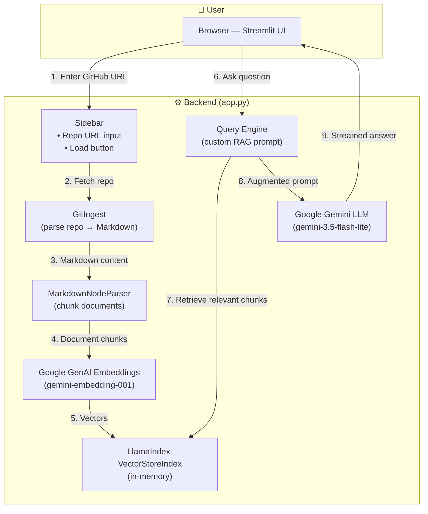
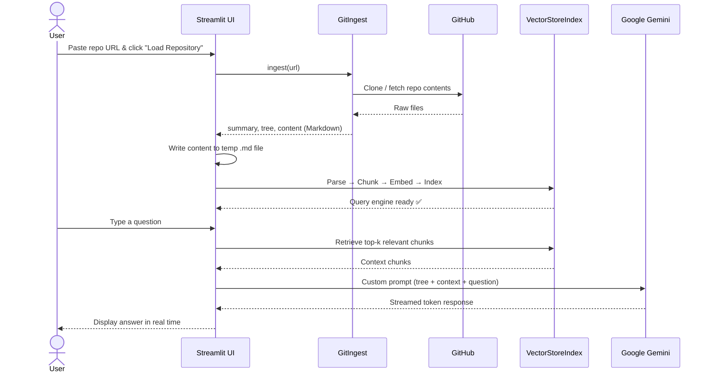

# 💬 Chat with Git

> **Ask questions about any public GitHub repository using AI-powered Retrieval-Augmented Generation (RAG).**

Paste a GitHub URL, and the app ingests the entire repo into a searchable vector index — then lets you have a natural-language conversation about its code, structure, and purpose.

---

## ✨ Features

- 🔗 **One-click repo ingestion** — paste any public GitHub URL
- 🧠 **RAG-powered Q&A** — answers are grounded in the actual repository content
- ⚡ **Streaming responses** — tokens appear in real time as the model generates
- 💡 **Suggested questions** — quick-start prompts to explore a repo instantly
- 🗂️ **Multi-repo sessions** — load and switch between multiple repositories
- 🔒 **Secure API key handling** — keys stay in `.env`, never exposed in the UI

---

## 🏗️ Architecture



---

## 🔄 End-to-End Data Flow



---

## 📂 Project Structure

```text
Chat with GIT/
├── app.py              # Main Streamlit application with Google Gemini RAG pipeline
├── app_local.py        # Offline/local app variant (Ollama llama3.2 + HuggingFace embeddings)
├── requirements.txt    # Python package dependencies (Streamlit, LlamaIndex, Google GenAI, etc.)
├── .env.example        # Template for required environment variables (GOOGLE_API_KEY)
├── .gitignore          # Git exclusion rules (secrets, caches, and temporary files)
├── explanation.pdf     # In-depth architectural flowcharts & technical documentation
├── run_app.bat         # Windows Command Prompt one-click startup script
├── run_app.ps1         # Windows PowerShell one-click startup script
└── README.md           # Comprehensive project documentation
```

---

## 🛠️ Tech Stack

| Layer | Technology | Purpose |
|-------|-----------|---------|
| **UI** | [Streamlit](https://streamlit.io/) | Interactive web interface |
| **Repo Parsing** | [GitIngest](https://github.com/cyclotruc/gitingest) | Convert GitHub repos to Markdown |
| **RAG Framework** | [LlamaIndex](https://www.llamaindex.ai/) | Document indexing, retrieval & query engine |
| **LLM** | [Google Gemini](https://ai.google.dev/) (`gemini-3.5-flash-lite`) | Natural language generation |
| **Embeddings** | [Google GenAI Embeddings](https://ai.google.dev/) (`gemini-embedding-001`) | Semantic vector embeddings |
| **Chunking** | LlamaIndex `MarkdownNodeParser` | Split Markdown into meaningful chunks |
| **Environment** | [python-dotenv](https://pypi.org/project/python-dotenv/) | Secure `.env` variable loading |
| **Alt LLM** | [Ollama](https://ollama.com/) (via `app_local.py`) | Optional local/offline LLM support |
| **Alt Embeddings** | [HuggingFace](https://huggingface.co/) (via `app_local.py`) | Local embedding model |

---

## 🚀 Getting Started

### Prerequisites

- **Python 3.9+**
- A **Google API key** with Gemini access → [Get one here](https://aistudio.google.com/apikey)

### 1. Install dependencies

```bash
pip install -r requirements.txt
```

### 2. Configure your API key

Create a `.env` file in the project root (use `.env.example` as a template):

```env
GOOGLE_API_KEY=your_google_api_key_here
```

### 3. Run the app

**Option A — Streamlit directly:**
```bash
streamlit run app.py
```

**Option B — Windows launcher scripts:**
```bash
# Batch
run_app.bat

# PowerShell
.\run_app.ps1
```

The app will open at **http://localhost:8501**.

### 4. (Optional) Run with local Ollama instead

```bash
streamlit run app_local.py
```

> Requires [Ollama](https://ollama.com/) with the `llama3.2` model pulled locally.

---

## 📖 How It Works — Step by Step

1. **User enters a GitHub URL** in the sidebar.
2. **GitIngest** clones/fetches the repo and converts it to a single Markdown document.
3. The Markdown is saved to a **temporary file**.
4. **LlamaIndex `SimpleDirectoryReader`** loads the file.
5. **`MarkdownNodeParser`** splits it into semantically meaningful chunks.
6. **Google GenAI Embeddings** convert each chunk into a vector.
7. Vectors are stored in an **in-memory `VectorStoreIndex`**.
8. When the user asks a question, the **Query Engine** retrieves the most relevant chunks.
9. A **custom RAG prompt** combines the repo tree, retrieved context, and the user's question.
10. **Google Gemini** generates a streamed response grounded in the repo's actual content.
11. The response is displayed **token-by-token** in the Streamlit chat interface.

---

## 👤 Author

**Madan Sai Jogi**
* GitHub: [@madhan-4413](https://github.com/madhan-4413)
* LinkedIn: [madhan-sai-8b1a29341](https://www.linkedin.com/in/madhan-sai-8b1a29341/)

---

## 🙏 Acknowledgements

| Who / What | Contribution |
|-----------|-------------|
| [**Patchy631 / ai-engineering-hub**](https://github.com/patchy631/ai-engineering-hub) | Original project inspiration and base repository (`github-rag`) |
| [**Google Gemini**](https://ai.google.dev/) | Large Language Model and Embedding APIs powering the RAG pipeline |
| [**LlamaIndex**](https://www.llamaindex.ai/) | RAG orchestration framework — indexing, retrieval, and query engine |
| [**GitIngest**](https://github.com/cyclotruc/gitingest) | GitHub repository-to-Markdown ingestion library |
| [**Streamlit**](https://streamlit.io/) | Python-first web UI framework for the chat interface |
| [**Ollama**](https://ollama.com/) | Local LLM runtime used in the alternative `app_local.py` |
| [**HuggingFace**](https://huggingface.co/) | Open-source embedding models for the local variant |
| [**python-dotenv**](https://pypi.org/project/python-dotenv/) | Secure environment variable management |

---

## 📄 License

This project is provided for educational and personal use.

---

<p align="center">
  <b>Built with ❤️ using Google Gemini, LlamaIndex & Streamlit</b>
</p>
