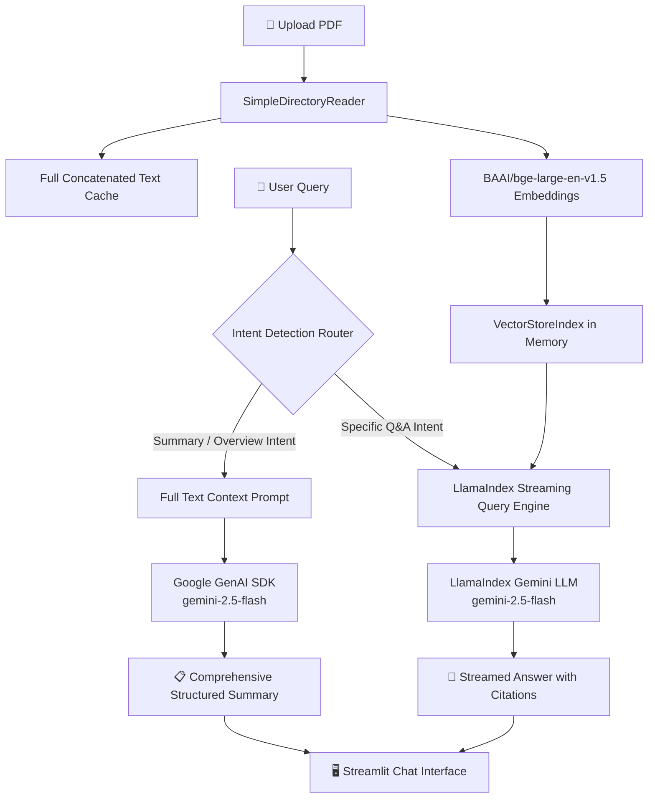

# 📄 Document Chat RAG (Retrieval-Augmented Generation)

An end-to-end, high-performance **Document Chat & Summarization RAG** web application built with **Google Gemini 2.5 Flash**, **LlamaIndex**, **Hugging Face Dense Embeddings**, and **Streamlit**.

The application features an **intelligent dual-mode pipeline**: it automatically routes broad synthesis and overview requests to Gemini's large context window for comprehensive document-wide summaries, while routing specific factual inquiries to a dense vector retrieval engine for precise, cited, and streaming answers.

---

## 🚀 Key Features

* **🤖 Powered by Google Gemini 2.5 Flash:** Ultra-fast, highly accurate reasoning and answer synthesis via Google's frontier multi-modal language model.
* **🔀 Intelligent Dual-Mode Routing:**
  * **Full-Document Summarization:** Detects summary/overview prompts and feeds the full document context directly to Gemini to bypass chunking fragmentation and deliver structured overviews, key concepts, data points, and takeaways.
  * **Contextual Vector RAG:** Indexes documents using state-of-the-art dense embeddings for pinpoint semantic chunk retrieval and step-by-step reasoning.
* **⚡ High-Quality Dense Embeddings:** Uses `BAAI/bge-large-en-v1.5` for industry-standard semantic similarity search.
* **💬 Real-Time Streaming Responses:** Answers stream interactively with typewriter animations as tokens are generated.
* **📑 Embedded PDF Preview:** Interactive, side-by-side embedded PDF viewer directly in the Streamlit interface.
* **🔒 Secure API Key Management:** Zero hardcoded secrets; seamlessly loads `GOOGLE_API_KEY` or `GEMINI_API_KEY` from a git-ignored `.env` file.
* **↺ One-Click Session Reset:** Clear chat history, caches, and memory with a single click.

---

## 🏗️ Architecture & Pipeline



1. **Document Ingestion:** The uploaded PDF is saved to a secure temporary directory and parsed using LlamaIndex's `SimpleDirectoryReader`.
2. **Text Caching & Indexing:** 
   - The full document text is extracted and stored in session state for holistic synthesis.
   - Chunks are vectorized using Hugging Face's `BAAI/bge-large-en-v1.5` dense embedding model and stored in an in-memory `VectorStoreIndex`.
3. **Intent Detection & Query Execution:**
   - **Summary Requests** (e.g., *"summarize this document"*, *"give me an overview"*, *"key points"*): Routed to `summarize_full_document()`, querying Gemini with the full document context.
   - **Specific Queries:** Executed against the vector query engine with custom step-by-step reasoning templates and streamed token-by-token.
4. **Interactive UI:** Split-pane interface providing live PDF preview alongside the conversational assistant.

---

## 🛠️ Tech Stack

| Component | Technology | Description |
|-----------|------------|-------------|
| **LLM Engine** | [Google Gemini 2.5 Flash](https://aistudio.google.com/) | Frontier model for fast, accurate generation and summarization |
| **RAG Framework** | [LlamaIndex](https://www.llamaindex.ai/) | Orchestration, indexing, and query engine (`llama-index-core`, `llama-index-llms-gemini`) |
| **Embedding Model** | [BAAI/bge-large-en-v1.5](https://huggingface.co/BAAI/bge-large-en-v1.5) | Dense semantic vector representations via Hugging Face |
| **SDKs** | `google-generativeai`, `llama-index-readers-file` | Direct Google GenAI API integration & document parsing |
| **Frontend UI** | [Streamlit](https://streamlit.io/) | Interactive web dashboard with real-time streaming and PDF preview |
| **Environment** | `python-dotenv` | Secure local configuration and environment variable loading |
| **Runtime** | Python 3.10+ / 3.11+ | Compatible with modern Python environments on Windows, Linux, and macOS |

---

## 🔑 API Key Configuration

This application requires a Google Gemini API key.

### 1. Obtain an API Key
Get your free API key from **[Google AI Studio](https://aistudio.google.com/app/apikey)**.

### 2. Configure Environment Variables
Create a `.env` file in the root of the project (you can copy `.env.example`):

```bash
cp .env.example .env
```

Add your API key to `.env`:
```env
GOOGLE_API_KEY=your_actual_gemini_api_key_here
```

> [!NOTE]
> The application supports both `GOOGLE_API_KEY` and `GEMINI_API_KEY` variable names.
> The `.env` file is included in `.gitignore` to prevent leaking credentials to version control.

---

## 📦 Getting Started

### 1. Clone the Repository
```bash
git clone https://github.com/madhan-4413/document-chat-rag.git
cd document-chat-rag
```

### 2. Set Up a Virtual Environment (Recommended)
```bash
# Windows (PowerShell)
python -m venv .venv
.venv\Scripts\Activate.ps1

# Linux / macOS
python3 -m venv .venv
source .venv/bin/activate
```

### 3. Install Dependencies
```bash
pip install -r requirements.txt
```

### 4. Set Up the `.env` File
Create `.env` and paste your Google Gemini API key as described in [API Key Configuration](#-api-key-configuration).

### 5. Run the Streamlit Application
```bash
streamlit run app.py
```

The application will launch automatically in your browser at `http://localhost:8501`.

---

## 📂 Project Structure

```
document-chat-rag/
├── app.py                             # Main Streamlit application with dual-mode RAG & summarization
├── requirements.txt                   # Project dependencies (LlamaIndex, Gemini, PyTorch, Streamlit)
├── .env.example                       # Template for environment variables (Google Gemini API key)
├── .gitignore                         # Prevents tracking secrets (.env), caches, and virtual environments
├── SETUP.md                           # Windows PowerShell-focused quickstart & troubleshooting guide
├── README.md                          # Comprehensive project documentation
├── AI_Feature_Suggestions_Roadmap.pdf # AI architecture & feature enhancements roadmap
├── changeslog.pdf                     # Visual changelog documenting recent updates & migrations
├── main_self_hosted_vectorDB.ipynb    # Exploration notebook for persistent vector databases (Qdrant)
└── rag_demo.ipynb                     # Exploratory RAG walkthrough notebook
```

---

## 🗺️ AI Features & Implementation Roadmap

A detailed roadmap of planned enhancements is documented in **[AI_Feature_Suggestions_Roadmap.pdf](AI_Feature_Suggestions_Roadmap.pdf)**:

* **Phase 1 (Quick Wins - Implemented!):** Intelligent full-document summarization mode, keyword-based query routing, and real-time streaming answers.
* **Phase 2 (Core Upgrades):** Persistent vector storage (Qdrant/ChromaDB), multi-document cross-referencing, and cross-encoder reranking (`bge-reranker-large`).
* **Phase 3 (Advanced AI):** Multimodal document parsing with Gemini Vision (charts, tables, handwritten notes), agentic tool calling (web search, calculator), and voice chat.

---

## 👤 Author

**Madan Sai Jogi**
* GitHub: [@madhan-4413](https://github.com/madhan-4413)
* LinkedIn: [madhan-sai-8b1a29341](https://www.linkedin.com/in/madhan-sai-8b1a29341/)

---

## 📄 License

This project is licensed under the MIT License — feel free to customize and extend it for your own AI & RAG applications!
